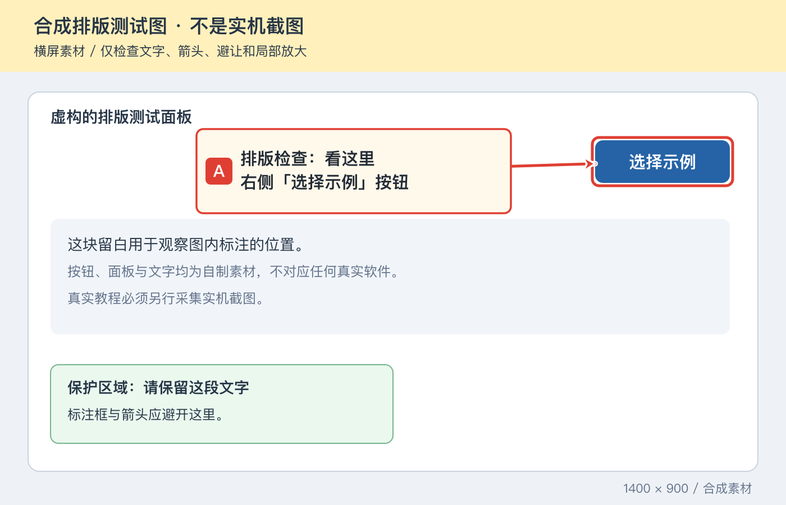

# 按钮级图文教程 · button-tutorial

一个给 AI Agent 使用的 Skill：为软件、网站和手机 App 制作零基础操作教程。沿真实界面拆分步骤，把动作文字、编号和箭头直接写入截图，再生成可以独立转发的标注图片与离线网页。

适合这样的请求：

> 给这个软件做一份新手教程，精确到每个按钮。把操作文字直接标在图里，用箭头指出要点哪里。



上图是明确标记的合成排版测试素材，用于演示标注效果；实际教程必须使用真实截图。

## 交付内容

- **单文件 `index.html`**：内嵌图片、样式和脚本，支持步骤导航、完成勾选、图片放大和保存标注图，可离线阅读。
- **独立 PNG**：图内已经带有动作文字和箭头，脱离网页转发后标注仍在。
- **按需追加**：用户要求时再生成 PDF、压缩包或练习材料。

Skill 包含采集、拆步骤、填写示例和成品验收规范。渲染器负责文字、目标框、箭头和网页排版；它不会代替 Agent 操作软件，也不会证明操作已经成功。

## 安装到 Codex

把整个仓库放进技能目录，不要只复制 `SKILL.md`。以下命令适用于 macOS / Linux；目标目录已存在时先检查已有内容。

```bash
git clone https://github.com/HamazuraShiage/button-tutorial.git "${CODEX_HOME:-$HOME/.codex}/skills/button-tutorial"
cd "${CODEX_HOME:-$HOME/.codex}/skills/button-tutorial"
npm ci
```

在新对话中使用 `$button-tutorial`，或直接描述“用真实截图做精确到按钮的图文教程”。支持目录式 Skill 的其他 Agent，也可将整个仓库放到它自己的技能目录；界面采集使用宿主实际具备的工具。

## 环境要求

- Node.js 22 或更新版本，以及 npm。
- Sharp：已在 `package.json` 声明，使用 `npm ci` 安装。
- 本机有能显示中文的字体，例如苹方、微软雅黑或 Noto Sans CJK SC；Linux 可安装 `fonts-noto-cjk`。截图里的中文不依赖本机字体，新增标注文字需要。
- 制作实际教程时，Agent 还需要可用的截图、浏览器或桌面操作工具。也可以使用用户提供的真实截图。

宿主已经提供 Node 与 Sharp 时，无需重复安装，可通过 `--node-modules` 指向已有库目录。

## 三步验证安装

在仓库根目录运行：

```bash
npm ci
npm test
npm run example
```

打开 `output/example/index.html` 查看两步排版示例，标注图位于 `output/example/images/`。示例运行时在本地生成横屏和竖屏测试素材，所有素材都明确标为合成测试图，不是实机截图。

## 制作自己的教程

1. 沿真实操作路径采集截图，记录版本、设备、起点和完成标志。
2. 参照 [步骤格式](references/steps-format.md) 填写 JSON，每步写清动作、图内文字、目标坐标和可见结果。
3. 生成后打开图片和网页，按 [采集与验收要点](references/capture-and-review.md) 核对。

```bash
node scripts/build_tutorial.mjs /path/to/steps.json --out /path/to/tutorial-output
```

可选参数：

```bash
node scripts/build_tutorial.mjs /path/to/steps.json --out /path/to/tutorial-output \
  --node-modules /absolute/path/to/node_modules \
  --font-family "Noto Sans CJK SC"
```

截图路径相对于 JSON 文件解析；坐标使用图片按 EXIF 正规化后的显示方向原始像素。目标框用 `[左, 上, 右, 下]`，文字框用 `[左, 上, 宽, 高]`。文字框放不下、遮住目标、截图缺失或坐标越界时，脚本会报错，修正清单后重新生成。

## 仓库内容

```text
SKILL.md                     Agent 的技能入口
agents/openai.yaml           Codex 显示信息与触发设置
scripts/build_tutorial.mjs   标注图片和离线网页生成器
references/                 步骤格式、采集与验收说明
examples/                   可复现的合成排版示例
tests/                      生成、错误处理与输入保护检查
docs/preview.png            示例效果预览
```

生成器不需要 API Key；安装依赖后，排版本身不访问网络。实际软件的登录、界面采集和操作权限由宿主环境与用户授权决定。
